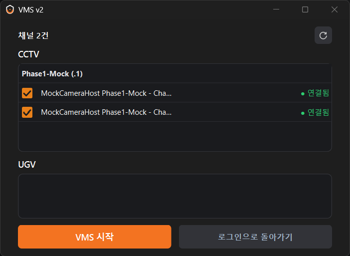
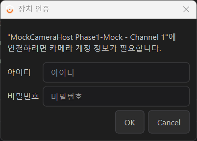
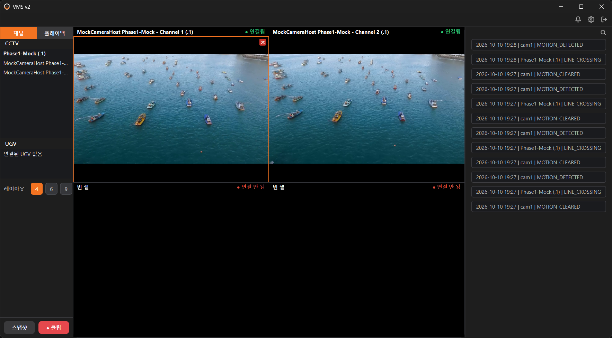
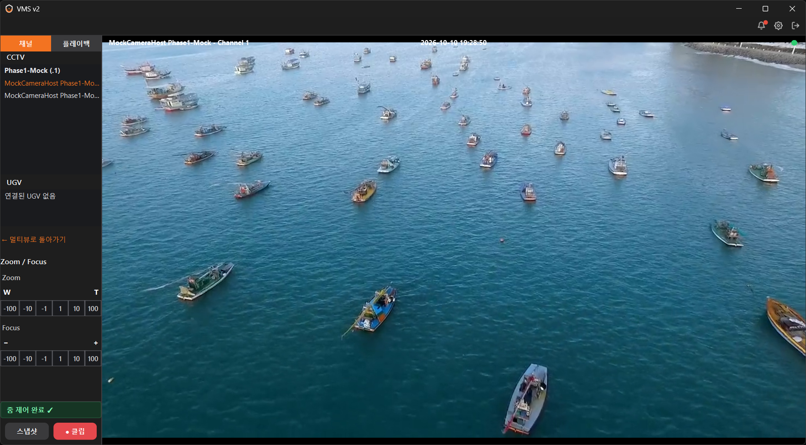
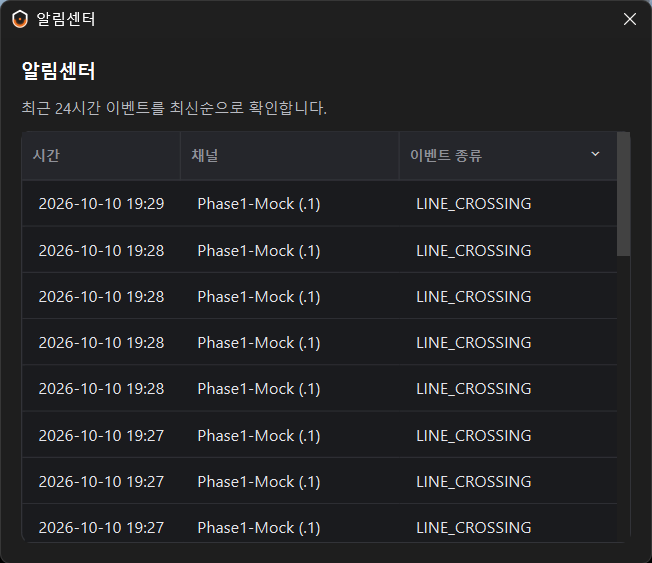
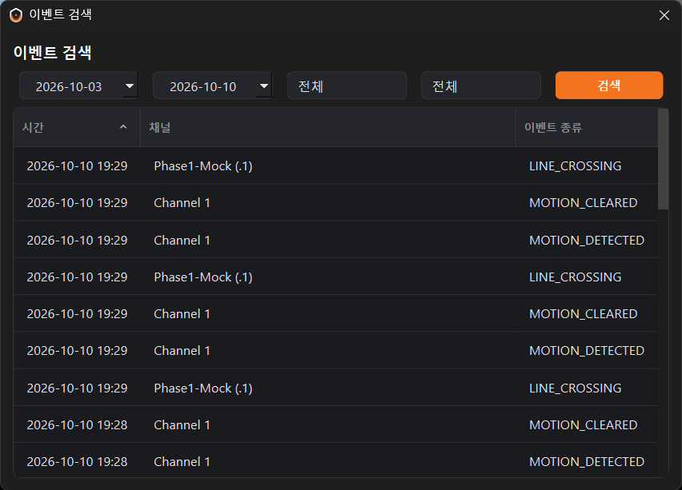

# standalone-vms

서버 없이 동작하는 VMS 클라이언트.

팀 프로젝트 [VEDA3-CLUE-VMS](https://github.com/gayeongit/VEDA3-CLUE-VMS)(`v2` 브랜치)의 VMS 파트를 기반으로, 서버를 거치던 장치 조회·카메라 제어·이벤트 수신을 카메라와의 직접 통신으로 바꿨습니다. 서버는 로그인 같은 선택 기능으로만 남습니다.

| | 원본 | 이번 프로젝트 |
|---|---|---|
| 장치/채널 조회 | 서버 REST (조회할 때마다 7~9회) | ONVIF로 최초 탐색 시 사전 조회 후 캐싱, 이후 조회는 네트워크 요청 0회 |
| zoom / focus | 서버 REST 프록시 | ONVIF PTZ / Imaging SOAP |
| 카메라 계정 | 서버가 대신 인증 | 로컬 입력 (게스트는 세션만, 로그인은 QtKeychain 저장) |
| 이벤트 수신 | 카메라 → 서버 → WS | 카메라 → UDP 직접 수신 |

## 화면

| | |
|---|---|
|  |  |
| 장치 탐색 | 카메라 계정 입력 |


RTSP 멀티뷰와 로컬 이벤트 목록


단일 채널 전체화면과 zoom / focus 제어

| | |
|---|---|
|  |  |
| 알림센터 | 이벤트 검색 |

## 구조

```
UI           screens / ui
Application  DeviceService · CctvControlService · EventService · ...
Infra        OnvifLiteClient · LocalEventListener · CredentialStore   (서버 없이 동작)
             RestClient · WsClient                                    (서버 있을 때만)
Media        StreamPlayer · ChannelSessionManager · ...
State        AppState
```

화면·미디어 계층과 서비스 인터페이스는 그대로 두고 서비스 내부 구현만 교체했습니다. 자세한 구조는 [docs/core_classes.md](docs/core_classes.md)에 있습니다.

## 실행

Windows, Qt 6.8, MSVC, GStreamer 기준입니다.

```bash
# 앱
cmake -B build
cmake --build build --target VMS_v2

# 목업 카메라 호스트
cmake -S mock_camera_host -B mock_camera_host/build -DCMAKE_PREFIX_PATH=C:/Qt/6.8.3/msvc2022_64
cmake --build mock_camera_host/build
```

목업 호스트에서 `onvif_mock.exe`, `event_broadcaster.exe`, mediamtx(+ffmpeg)를 실행한 뒤 앱에서 **게스트로 시작**을 누르면 됩니다. 카메라 계정은 `admin` / `admin1234`입니다.

`app_config.json`은 선택 사항입니다. 서버를 쓸 때만 `app_config.example.json`을 복사해서 채우면 됩니다.

## 제한 사항

- 실제 카메라가 아닌 목업 호스트로만 검증했습니다.
- Playback은 녹화 서버가 필요해서 범위에서 뺐고, 로그인 상태에서만 동작합니다.
- 로컬 UDP 이벤트는 인증이 없어 신뢰할 수 있는 LAN을 전제로 합니다.
- 자동 테스트 없이 수동 시나리오로 검증했습니다.

## 문서

- [docs/roadmap.md](docs/roadmap.md) — 단계별 계획
- [docs/dev_execution_plan.md](docs/dev_execution_plan.md) — Phase별 작업 기록
- [docs/refactoring_improvements.md](docs/refactoring_improvements.md) — 개선 내용 요약
